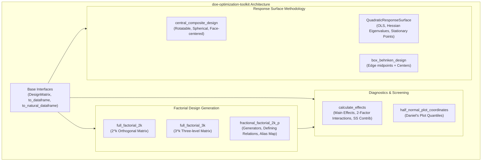

# `doe-optimization-toolkit`

[](tests/)
[](pyproject.toml)
[](LICENSE)
[](#about-this-project--ai-collaboration)

> **Classical industrial engineering experimental design and surface modeling made programmatic: Full & Fractional Factorial Designs, Alias Structures, Half-Normal Probability Screening, Central Composite Designs, and Quadratic Response Surface Optimization.**

---

## About This Project & AI Collaboration

This repository is part of a deliberate open-source portfolio and technical learning initiative developed with the assistance of **Gemini Flash (Antigravity)**.

The primary goals of this project are:
* **Practicing Software Craftsmanship**: Designing modular, typed, and idiomatic Python libraries for industrial and systems engineering workflows.
* **Revising Theoretical & Methodological Foundations**: Implementing the mathematical mechanics of design generation, group-theoretic defining relations ($I = ABCD$), alias expansion, Daniel's half-normal probability quantiles, and canonical Hessian classification for response surfaces.
* **Testing AI-Assisted Engineering Approaches**: Evaluating and benchmarking agentic AI pairing workflows (using **Gemini Flash**) for experimental design generation, mathematical LaTeX documentation, and test verification.

---

## 1. Architectural Overview



---

## 2. Key Modules & Mathematical Capabilities

### 2.1 Factorial & Fractional Factorial Designs
* **Full Factorial Designs ($2^k, 3^k$):** Fully orthogonal coded design generation ($-1, +1$) satisfying $X^T X = N \cdot I_k$, with optional center points and natural engineering unit conversion.
* **Fractional Factorials ($2^{k-p}$):** Automatically constructs fractional factor columns using generator formulas (e.g. `D = A*B*C`), calculates the complete defining relation ($I = ABCD$), identifies design resolution (III, IV, V), and computes the full alias structure for main effects and interactions.

### 2.2 Diagnostic Screening & Daniel Plots
* **Effect & SS Decomposition:** Computes contrasts, main effects, coefficients, and percentage contributions to total variance.
* **Daniel's Half-Normal Plot:** Identifies sparse active factors in unreplicated experiments by computing half-normal plotting positions:
  $$p_i = \frac{i - 0.5}{m}, \quad z_i = \Phi^{-1}(0.5 + 0.5 p_i)$$

### 2.3 Response Surface Methodology (RSM)
* **Central Composite Design (CCD):** Supports rotatable ($\alpha = (2^k)^{1/4}$), spherical ($\alpha = \sqrt{k}$), and face-centered ($\alpha = 1.0$) designs.
* **Box-Behnken Design (BBD):** Three-level designs without extreme axial points.
* **Quadratic Surface Optimization & Canonical Analysis:** Solves for the stationary point:
  $$x_s = -\frac{1}{2} B^{-1} b$$
  and classifies its nature (Maximum, Minimum, Saddle Point) via the eigenvalues of Hessian matrix $B$.

---

## 3. Mathematical Foundations

Detailed analytical derivations are available in [`docs/`](docs/):

* **[Factorial & Fractional Designs](docs/01_factorial_designs.md)**: Orthogonality proofs, generator algebra, defining relations, and alias structures.
* **[Effects & Daniel Plots](docs/02_effects_and_daniel_plots.md)**: Contrasts, sum of squares contributions, and half-normal probability plotting.
* **[Response Surface Methodology](docs/03_response_surface_methodology.md)**: CCD geometries, rotatability criteria, second-order polynomial modeling, and Hessian canonical analysis.

---

## 4. Quickstart Guide

### Installation

```bash
git clone https://github.com/gabriel/doe-optimization-toolkit.git
cd doe-optimization-toolkit
pip install -e .
```

### Fractional Factorial Design with Alias Structure

```python
from doe_toolkit.factorial import fractional_factorial_2k_p

factors = ["A", "B", "C", "D"]
generators = {"D": "A*B*C"}
design, alias_map, resolution = fractional_factorial_2k_p(factors, generators)

print(f"Design Resolution: {resolution}")
for effect, aliases in alias_map.items():
    print(f"  {effect} = {' + '.join(aliases)}")
```

### Central Composite Design & Quadratic Optimization

```python
from doe_toolkit.rsm import central_composite_design, QuadraticResponseSurface

factors = ["Temperature", "Concentration"]
levels = {"Temperature": (140.0, 180.0), "Concentration": (10.0, 30.0)}

ccd = central_composite_design(factors, alpha="rotatable", center_points=5, factor_levels=levels)

# Fit quadratic response surface to experimental data
surface = QuadraticResponseSurface().fit(ccd, y_experimental)
res = surface.optimize()

print(f"Stationary Point Nature: {res.nature}")
print(f"Optimal Natural Conditions: {res.point_natural}")
print(f"Predicted Response: {res.predicted_response:.2f}%")
```

---

## 5. Running Tests & Walkthrough

Run the test suite:

```bash
pytest -v
```

Execute the live demonstration:

```bash
python notebooks/run_doe_walkthrough.py
```

---

## 6. License

This project is licensed under the MIT License - see the [LICENSE](LICENSE) file for details.
